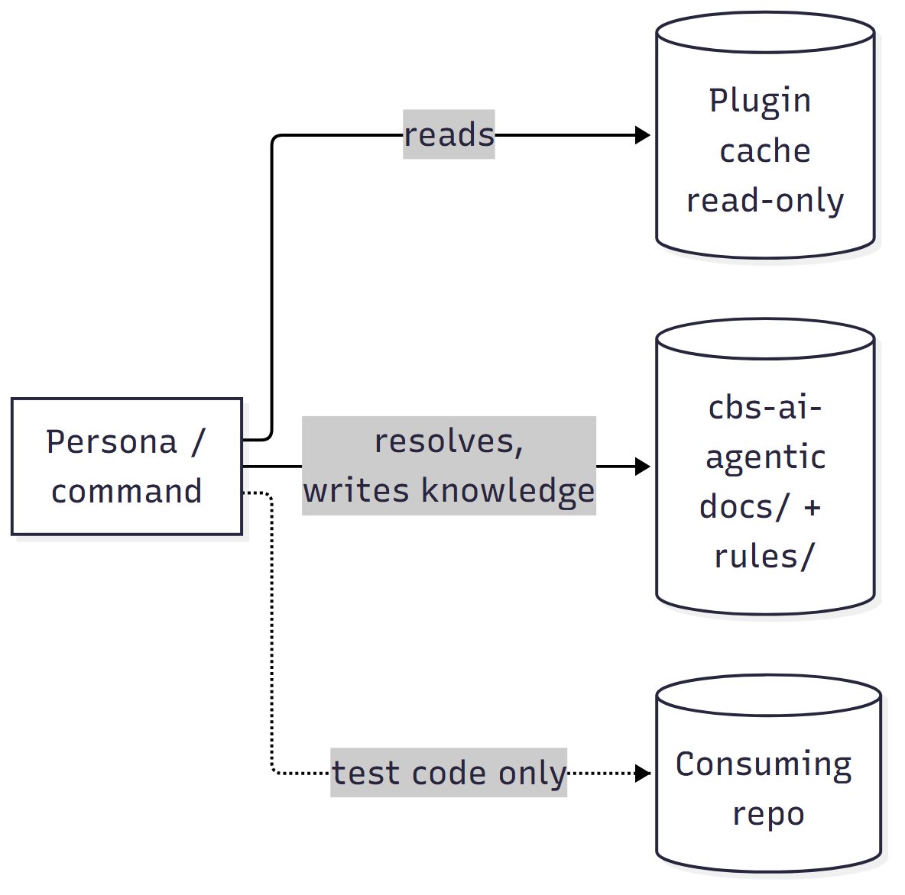
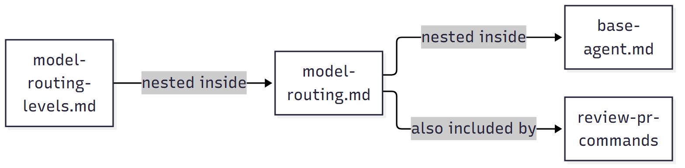
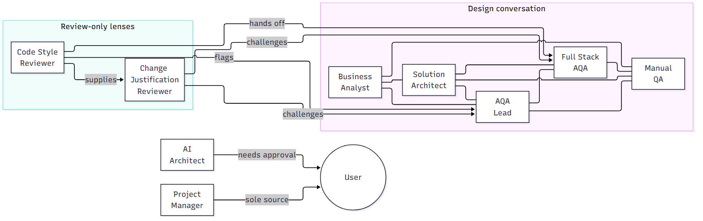
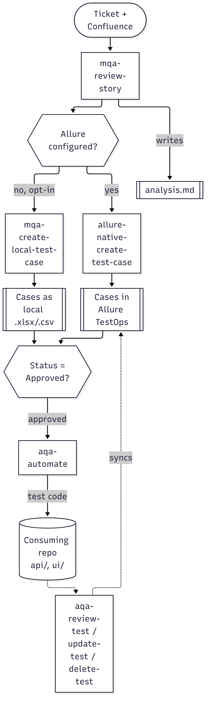
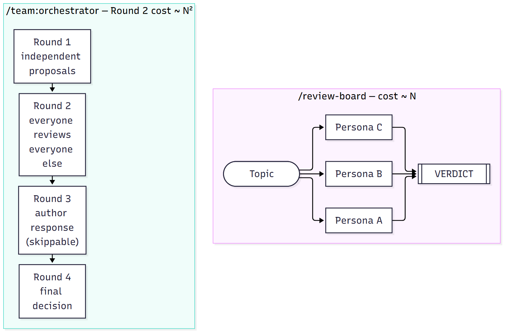
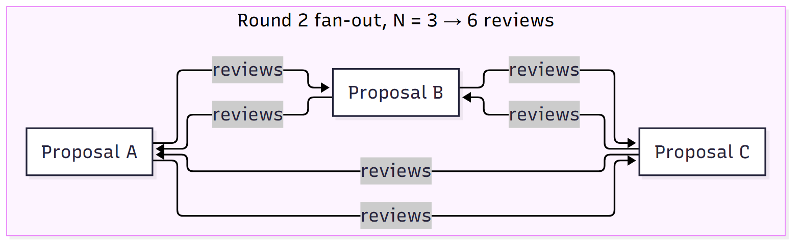
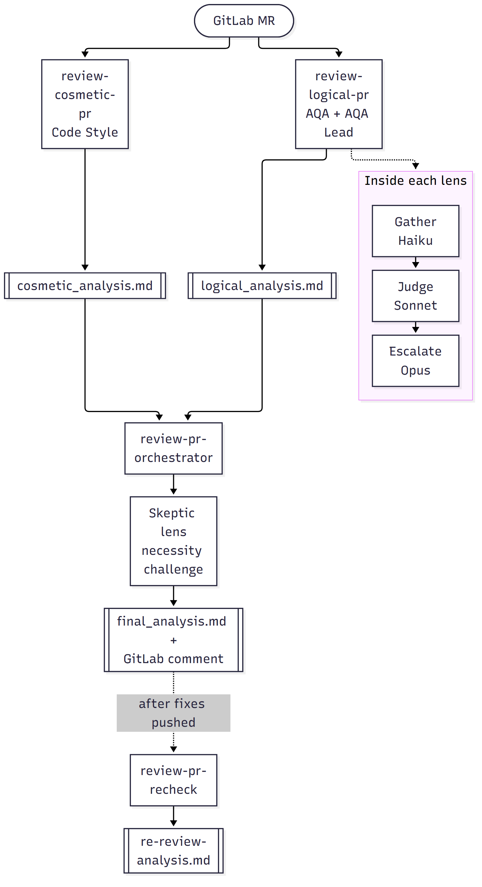
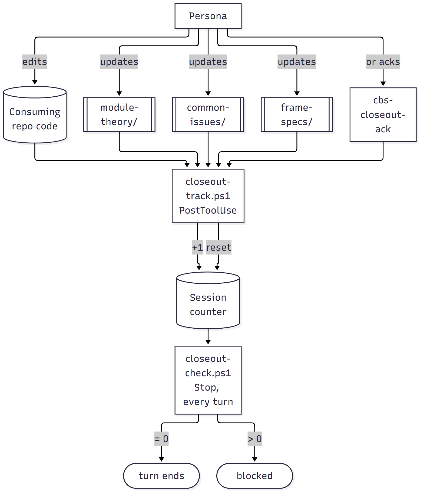

# proj-ai-agentic — Architecture

This document draws the mechanisms behind `claude-proj-agent`: what depends on what, which roles
talk to which, and how a task actually moves through the system. It complements `README.md` (setup,
full command catalog) and `CLAUDE.md` (the accepted portability trade-off) — it doesn't replace
either. Diagrams here show *how something works*, not a restated file listing; where a table says
it faster, this file uses a table instead.

Diagrams are pre-rendered PNGs (Bitbucket doesn't render Mermaid); the editable source of each is
the `.mmd` file linked under it. After editing a `.mmd`, regenerate its image from the repo root:
`npx -y @mermaid-js/mermaid-cli -i diagrams/<name>.mmd -o diagrams/<name>.png -s 2 -b white`

Last updated: 2026-10-07, against the structure on disk as of that date. If a diagram here disagrees
with the actual `commands/`/`docs/` tree, trust the tree and fix this file — a stale architecture
diagram is worse than none.

## Contents

1. [Repository & persistence topology](#1-repository--persistence-topology)
2. [Include graph — what changes when you edit a shared file](#2-include-graph--what-changes-when-you-edit-a-shared-file)
3. [The nine roles and who actually talks to whom](#3-the-nine-roles-and-who-actually-talks-to-whom)
4. [The QA pipeline — a prompt chain with one hard checkpoint](#4-the-qa-pipeline--a-prompt-chain-with-one-hard-checkpoint)
5. [Two ways to get a second opinion — and why they cost differently](#5-two-ways-to-get-a-second-opinion--and-why-they-cost-differently)
6. [MR review: four lenses, one merge, one adversary](#6-mr-review-four-lenses-one-merge-one-adversary)
7. [The docs knowledge base and its enforcement hook](#7-the-docs-knowledge-base-and-its-enforcement-hook)
8. [Bundled skills and services](#8-bundled-skills-and-services-no-external-plugin-dependencies)
9. [Keeping the framework honest: validator, verification protocol, metrics](#9-keeping-the-framework-honest-validator-verification-protocol-metrics)

---

## 1. Repository & persistence topology

Three places look similar but are not interchangeable, and the framework depends on never
confusing them: the read-only plugin install, the writable knowledge base, and the product repo
that must stay clean of any trace of this framework.

*Source: [`diagrams/01-repository-topology.mmd`](diagrams/01-repository-topology.mmd)*

**The mechanism that matters**: `${CLAUDE_PLUGIN_ROOT}` and the real `proj-ai-agentic` working tree
look like the same thing to a careless read — they're not. The cache holds `commands/`, `hooks/`,
`.claude-plugin/` and has no `.git` and isn't committable; a file a task expects to already exist
there (last week's `analysis.md`) may simply be missing because the cache predates it. `docs/`
(`project-spec/`, `frame-specs/`, `module-theory/`, `common-issues/`, `chat-history/`) and `rules/`
live only in the real working tree, resolved via sibling-directory search (this deployment's
`extraKnownMarketplaces` entry is a `git` source with no local path) — see `base-agent.md`'s
"Repository & Persistence Model" for the exact order. The consuming repo (e.g.
`proj-test-automation`) gets test *code* from `aqa-automate` and nothing else — no docs, no rules,
no trace of this framework.

---

## 2. Include graph — what changes when you edit a shared file

Personas aren't 9 independent prompts — most of their content comes from three shared files via
Claude Code's `@`-include mechanism, which really does splice the target file's content into the
persona's own context at invocation time. Editing one of these three has a blast radius; the
diagram below is that blast radius made visible.

A many-to-many "who includes what" relationship draws as a tangle of crossing lines no matter how
short the labels are — a table says it cleaner. The one real *chain* (`model-routing-levels.md`
nests inside `model-routing.md`, which itself nests inside `base-agent.md`) is the only part worth
drawing:

*Source: [`diagrams/02-include-graph.mmd`](diagrams/02-include-graph.mmd)*

| Persona | `base-agent.md` | `context-resolution.md` |
|---|:---:|:---:|
| `analyst-agent` | ✅ | ✅ |
| `architect-agent` | ✅ | ✅ |
| `aqa-lead-agent` | ✅ | ✅ |
| `manual-qa-agent` | ✅ | ✅ |
| `fullstack-aqa-agent` | ✅ | ✅ |
| `code-style-agent` | ✅ | ✅ |
| `skeptic-agent` | ✅ | ✅ |
| `pm-agent` | ✅ | ✅ |
| `ai-architect-agent` | ✅ | ❌ |

**Read the empty cell, not just the checkmarks**: `ai-architect-agent` is the one persona *not*
wired to `context-resolution.md` — deliberately, since its whole mandate is this repo's own
meta-layer, not a CBS ticket's domain/module context. Every ✅ in the `base-agent.md` column means
the same thing: a change there is a change to all nine roles at once (`model-routing.md`'s
Gather/Judge/Escalate convention travels with it, nested inside), which is exactly why editing
`base-agent.md` is gated behind explicit user consultation (`ai-architect-agent.md`'s own Decision
Boundaries).

---

## 3. The nine roles and who actually talks to whom

Pulled directly from each persona's own `Collaboration` section — not an invented org chart. Seven
roles own the CBS product; the AI Architect owns the framework that hosts them; the PM is scoped to
personal timesheet logging and stays out of both.

*Source: [`diagrams/03-roles.mmd`](diagrams/03-roles.mmd)*

**What the shape says**: the five design-conversation roles form one dense cluster (everyone
reviews or is reviewed by 3-4 neighbors) — that's the normal QA/BA/Architecture back-and-forth. Code
Style and Skeptic sit apart on purpose: they're review-only lenses (`review-pr-commands`), never
design authors, which is why their edges only point outward as challenges, never inward as
proposals. Code Style flags naming/pattern drift to AQA Lead, hands off anything needing design
judgment to Full Stack AQA, and supplies Skeptic with non-duplicate candidates it can still
challenge on necessity grounds; Skeptic cross-examines both AQA lenses' "this is correct/this fits"
conclusions. AI Architect keeps all of that tooling coherent without second-guessing it, and needs
the user's sign-off only for a `base-agent.md` change; PM's sole source of truth for hours is the
user directly.

---

## 4. The QA pipeline — a prompt chain with one hard checkpoint

This is Anthropic's own "prompt chaining" pattern by the book: fixed sequential steps, each
consuming the previous step's output, with one explicit checkpoint gating the expensive step.

*Source: [`diagrams/04-qa-pipeline.mmd`](diagrams/04-qa-pipeline.mmd)*

**The checkpoint is the point**: `aqa-automate` never runs against a case that isn't `Approved` —
that single gate is what stops automation effort being spent on a case the joint review
(`/review-board manual-qa,aqa,analyst`) hasn't actually signed off yet. The Allure/local fork is
mutually exclusive per ticket, never both (`rules/allure.md`).

---

## 5. Two ways to get a second opinion — and why they cost differently

Both commands take a topic and a participant list. Their actual cost profiles are not remotely
similar, and that difference is exactly what decides which one to reach for.

*Source: [`diagrams/05-second-opinion-a.mmd`](diagrams/05-second-opinion-a.mmd)*

*Source: [`diagrams/05-second-opinion-b.mmd`](diagrams/05-second-opinion-b.mmd)*

**Why this is drawn twice**: the top diagram compares the two commands' *shape*; the bottom one
makes the cost concrete. `N × (N-1)` reviews means 3 participants cost 6 write-ups, but the naive
default of "all nine personas" costs 72 — most of them from a persona whose domain has nothing to
do with the question. `orchestrator.md` now refuses that default and asks for 2-4 relevant
participants explicitly; `commands/team/INDEX.md` has the full decision table for which command to
reach for at all. Round 3 only runs for a proposal whose Round 2 review actually found a weakness —
otherwise the moderator skips straight to Round 4 over the unmodified proposal.

---

## 6. MR review: four lenses, one merge, one adversary

`review-pr-commands` splits what used to be one joint 4-lens review into narrower passes, each
internally following the Gather/Judge/Escalate model-routing convention so the expensive model only
runs where a judgment actually gets rendered.

*Source: [`diagrams/06-mr-review.mmd`](diagrams/06-mr-review.mmd)*

**Where the adversary sits**: Skeptic never re-litigates correctness (that's the AQA/AQA Lead
lenses' job) or cosmetic conformance (Code Style's job) — it only challenges whether a
non-trivial change was *necessary*, resolving every challenge it raises as Justified or Not
Justified before the merged report ships.

---

## 7. The docs knowledge base and its enforcement hook

`docs/module-theory/`, `docs/common-issues/`, and `docs/frame-specs/` are meant to accumulate the
kind of durable knowledge a long-tenured engineer would carry around — and, as of today, that
accumulation is enforced technically, not just requested in a prompt. This is the closeout pair;
three more `PostToolUse`/`Stop` pairs exist alongside it for other prose conventions —
`delegation-track.ps1`/`delegation-check.ps1` for `model-routing.md`'s Gather-stage delegation,
`model-routing-track.ps1`/`model-routing-check.ps1` (plus the `UserPromptSubmit`
`model-routing-classify.ps1`) for `model-routing.md`/`model-routing-levels.md`'s mandatory
per-message complexity classification, and `version-bump-track.ps1`/`version-bump-check.ps1`
(a `plugin.json` version bump after a plugin-cache-served file was edited) — see `README.md`'s
hooks bullet for all four. Only the closeout pair is diagrammed below.

*Source: [`diagrams/07-docs-enforcement.mmd`](diagrams/07-docs-enforcement.mmd)*

**Why a hook and not just a rule**: `context-resolution.md`'s Task Closeout Protocol already asked
for this in prose; it was reliably skipped in practice once a task's own context grew. The hook
pair is a technical backstop for exactly that failure mode — the same precedent as
`classify-http-readonly.ps1`'s guard that hard-denies a `git commit` whose message carries an
AI attribution line (it checks commit, tag, `gh pr` and `glab` text, not Jira, Confluence or chat comments), which exists because
a prompt-only version of *that* rule already failed once. `module-theory/` here means the specific
`docs/module-theory/<Module>/INDEX.md` touched (including its "Patterns & Predictive Rules"
section); the ack path is a literal `Bash: echo proj-closeout-ack: <reason>` when nothing needs
recording; "blocked" means the `Stop` hook names exactly what's still open in its response, not a
silent failure. The hook only tracks *whether* a closeout happened, never *what* the right update
was — that judgment stays the persona's.

---

## 8. Bundled skills and services (no external plugin dependencies)

Since 2.0.0 `plugin.json` declares no dependencies. Everything formerly pulled from
`bank-proj-marketplace` and still in use is vendored inside the plugin: skills under `external_skills/`
(invoked as `claude-proj-agent:<name>`) and remote MCP servers in `.mcp.json` (tools named
`mcp__plugin_claude-proj-agent_<server>__<tool>`). The vendored content is a dated snapshot of a
pinned upstream commit, tracked in `third_party/bank-proj-marketplace/NOTICE.md` and described in
`docs/architecture/bank-vendoring/bank-vendoring.md` (sync procedure, 60-day freshness rule).

| Bundled item | Kind | Used for | Invocation |
|---|---|---|---|
| `atlassian-routing` | skill | Picks the innowise vs bank Atlassian server | Auto |
| `atlassian-innowise`, `atlassian-bank` | MCP servers | Jira/Confluence access, one per site | Tools (OAuth in `/mcp`) |
| `bruno`, `bruno-validate` | skills | The real API contract (`proj-bruno-api` collection), request-file audits | Auto / on request |
| `mermaid-ai` | MCP server | Diagram generation for Business Flows/architecture | Tools |
| `proj-context`, `nfr` | skills | CBS platform terminology, NFR register | Auto |
| `bluedot` | skill + MCP server | Meeting recording/transcript queries | On request (OAuth in `/mcp`) |
| `k8s-connect`, `k8s-read-only` | skills | Cluster connect + read-only diagnostics | On request |

Dropped in 2.0.0 and not documented as dependencies: `proj-devops`, `notebooklm`, `spotless`,
`proj-use-cases`, `tech-writer`.

---

For the full command catalog with invocation syntax and examples, see the root `README.md`. For the
single accepted architectural trade-off this repo currently lives with (docs/rules scoped to one
consuming repo, not yet namespaced for multiple), see `CLAUDE.md`'s "Architecture Note."

---

## 9. Keeping the framework honest: validator, verification protocol, metrics

Three mechanisms keep the team's own tooling from drifting and make its value measurable. None of them
changes a persona's judgment; each is a technical backstop for something that prose alone did not hold.

| Mechanism | Where | What it does | Why it exists |
|-----------|-------|--------------|---------------|
| Drift validator | `scripts/validate-framework.js` | Read-only scan of the plugin tree: command and file references that resolve to nothing, `INDEX.md` and README catalogs against the disk, Jira/Confluence write instructions, test runs that skip the environment question, hook registration, vendored-skill hygiene. FAIL blocks a clean state, WARN is reported | Renames of the allure commands left about ninety dead references behind and the manual Framework Health Checklist did not catch them |
| Verification and mutation protocol | `commands/team/verification-protocol.md` | Evidence instead of assertion; a test is run only while fixing, automating or changing a test and only after the owner names the environment; Jira and Confluence stay read-only; explicit stops before commit, push, PR, Allure writes and deletions | Commands asked for "all tests pass" and for Jira comments, which contradicted how the team actually works |
| Usage metrics | `scripts/metrics/metrics.js`, `docs/metrics/`, the `Stop` hook, `/metrics` | Appends per-person data (sessions, active time, lines, own commits and knowledge-base commits on main, hook activity) after every turn. Reports are rebuilt locally, only the data files are committed | A measured basis for showing the value of the plugin, with no prompts, model or vendor names in the files |

How they fit together: the validator checks the files, the protocol governs what a command may claim and
do, and the metrics hook records what actually happened. The `.ps1` hooks share `hooks/hook-common.ps1`;
the metrics hook is a Node script because it parses session files and git history.
