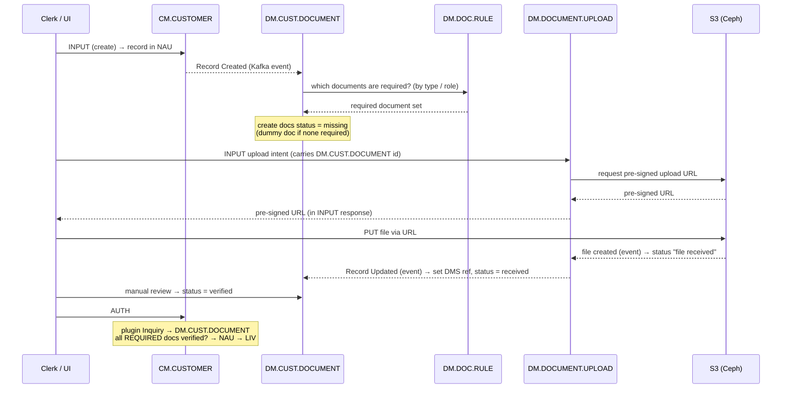

# Customer (Party) — master data & lifecycle reference

This is an **opt-in** reference covering the CBS **Customer (Party)** module: how a
customer (or pre-customer party) is created, documented, authorized, related to other
parties, and given an external login. It is **not** loaded automatically with the core
context — the `proj-context` skill offers it after `system-core.md` loads, and reads it
only if the user opts in.

> **Scope — two specifications.** The module is built from two specs:
> 1. **EP-03.01 | Customer (Party) Master Data Management** — the customer/party entity,
>    its lifecycle, prospects, and relationships (the bulk of this document).
> 2. **3rd Party Hooks (KYC & AML Compliance, Regional, CRM)** — external integrations
>    linked to the customer via hooks. The document workflow below is where KYC/AML
>    obligations surface in the core flow.
>
> **Cross-references.**
> - The operations (`INPUT`, `AUTH`, `SEE`, `REVERSE`, Inquiry), the storage spaces
>   (`NAU`/`LIV`/`HIS`/`DEL`), the `CUS`/`INT`/`FIN` table types, the 4-eyes lifecycle,
>   hooks, and Kafka events referenced below are all defined in `system-core.md`.
> - The concrete Table IDs used here (`CM.*`, `DM.*`, `SM.USER`, `ST.ROLE`) are indexed in
>   `references/tables.md`, each with a link to its Confluence spec — treat those specs as
>   canonical when they and this summary disagree.
> - Document Management (`DM.*`) isз a **separate module**; only the parts a customer flow
>   touches are covered here.
>
> **Source & freshness.** Distilled from the **Customer Module workshop (2026-07-03)**
> plus the Confluence Table specs. The workshop was improvised and several points were
> explicitly left open — those are flagged inline and collected under *Open questions*.
> A **naming caveat** worth keeping: the workshop audio repeatedly said "CAS", which is a
> mishearing of two different things — the **`CUS`** table *type* (data-scope) and the
> **`DM.CUST.DOCUMENT`** *table* (`CUST` = customer). There is no "CAS" in the model.

---

## TL;DR — if you remember only this

1. **Customer never goes straight to `LIV`.** `CM.CUSTOMER` always flows `NAU` → `AUTH` →
   `LIV`, even when its `CUS` data-scope resolves INT-like. Authorization is enforced via
   the projections, not skipped.
2. **Documents gate authorization.** A customer can't be authorized until every **required**
   document sits in status **verified**. Optional documents don't block and can come later.
3. **Document provisioning is event-driven.** `CM.CUSTOMER` doesn't call Document Management
   synchronously — it emits **Record Created / Record Updated** (Kafka), and
   `DM.CUST.DOCUMENT` reacts, deriving the required set from `DM.DOC.RULE`.
4. **Files never pass through Tables.** `DM.DOCUMENT.UPLOAD` mints a **pre-signed S3 (Ceph)
   URL**; the client uploads/downloads directly; S3 events feed the status back.
5. **A prospect is a `CM.MISC.PARTY`.** Promotion creates a `CM.CUSTOMER` from it, re-points
   its relationships to the new customer ID, and `REVERSE`s the party out to `HIS`.
6. **Relationships are always bidirectional.** Setting A→B must also write B→A
   (`CM.RELATION.TYPE` carries the reciprocal reverse code).
7. **An external user needs a customer role.** `SM.USER` (type `EXTERNAL`) attaches to a
   `CM.CUSTOMER` that already carries an `ST.ROLE`; it starts **inactive** and activates
   only after its **role-specific** documents are verified.

---

## 1. `CM.CUSTOMER` — the master party entity

- One record per party. Customer is broad — **Retail, Corporate, Bank, Prospect**:
  individuals *and* organizations, not only walk-in physical persons.
- It is a **`CUS`** table: its data is either shared bank-wide (INT-like) or isolated per
  Master Company (FIN-like), decided **globally** by the `SHARE_CUS_DATA` system parameter
  — never per record.
- **Storage rule (the golden rule).** A customer is never written straight to `LIV`. Even
  when the `CUS` scope resolves INT-like, the projections force the **`NAU` → `AUTH` →
  `LIV`** path — always unauthorized space first, then 4-eyes authorization.

## 2. Create-customer flow

- `INPUT` lands the record in `NAU` (status `UNAU`), awaiting `AUTH`.
- In the background `CM.CUSTOMER` **publishes a Record Created event** (Kafka, async — not a
  synchronous call) to `DM.CUST.DOCUMENT`. Table events come in three kinds:
  **Record Created / Record Updated / Record Deleted**.
- `DM.CUST.DOCUMENT` runs an **event-handler plugin** (distinct from a projection/validation
  hook) that:
  1. Determines the required document set for this customer type.
  2. Queries **`DM.DOC.RULE`** (Drools/DMN — evaluates role, product type, customer sector)
     to decide which documents apply.
  3. Creates those documents on `DM.CUST.DOCUMENT` with status **missing**.
- **Dummy document.** If the rules require *no* documents, create a single dummy document so
  the system can confirm the event processed successfully. Absence of any document would
  otherwise be indistinguishable from a failed/unprocessed event.
- **Naming note.** The workshop called the rules table "Business Rules" (target) and
  "Document Rules" (current); the concrete implementation is `DM.DOC.RULE`, still being
  updated.

## 3. Document lifecycle, upload & download

The document flow is shared by every module; here it satisfies a `DM.CUST.DOCUMENT`
obligation.

**Status lifecycle:** `missing` → `received` → `verified` (optional docs never block).

- **Upload.** `DM.DOCUMENT.UPLOAD` receives an `INPUT` ("I want to upload a file") carrying
  the **`DM.CUST.DOCUMENT` record ID** it satisfies. It carries no bytes — it asks
  **S3 (Ceph)** for a **pre-signed upload URL**, returned in the `INPUT` response; the client
  uploads directly to S3. **Tables never move file bytes.**
- **Feedback.** On upload S3 emits an event → `DM.DOCUMENT.UPLOAD` flips to "file received",
  then propagates a **Record Updated** event to `DM.CUST.DOCUMENT` to set the DMS/S3
  reference and move the obligation to **received**. This link step is now **event-based**
  (previously synchronous).
- **Manual verification.** `received` is not enough to authorize — a bank clerk must review
  and explicitly move the document to **verified** (deliberately manual; the uploader is a
  bank employee, but the content still needs a second pair of eyes).
- **Download.** A read (`SEE`) on `DM.CUST.DOCUMENT` triggers a hook that asks S3 for a
  **pre-signed download URL**, valid ~1–2 minutes then expiring. The raw bucket location is
  never exposed.
- **Siblings (out of scope here).** `DM.TRANS.DOCUMENT` (contract/transaction obligations)
  and the image tables `DM.IMAGE.TYPE` / `DM.IMAGE.UPLOAD` / `DM.DOCUMENT.IMAGE` follow the
  same S3 pattern.

## 4. Authorize-customer flow

- A manager runs `AUTH` on `CM.CUSTOMER`.
- A plugin runs an **Inquiry** into `DM.CUST.DOCUMENT` for this customer's documents.
- Only **required** documents block `AUTH`; **optional** ones can be uploaded later
  (e.g. 5 created → 2 required, 3 optional).
- Every required document must be **verified**; `AUTH` is rejected until all required
  documents are uploaded and verified. Only then does the record move `NAU` → `LIV`.

## 5. Prospect → Customer promotion

- Prospects (and UBOs, external signatories) live in **`CM.MISC.PARTY`** — a non-financial
  pre-customer register.
- Create a prospect via `INPUT`; it must be in `LIV` to be promoted (**likely** requires its
  own `AUTH` first — not confirmed in the workshop).
- **Promote** by creating a `CM.CUSTOMER` via `INPUT` and passing the existing
  **`CM.MISC.PARTY` ID**; much of the prospect's data carries over automatically.
- At promotion (`AUTH`):
  - **Re-point relationships.** Any `CM.CUSTOMER.RELATIONSHIP` rows referencing the misc-party
    ID must be updated to the **new customer ID**.
  - **Retire the party.** `REVERSE` the `CM.MISC.PARTY` record — it moves to `HIS` (its
    catalog behaviour: "reversed out to history once promoted"). It is not hard-deleted.
- **Delete vs reverse (recap of `system-core.md`).** A version-1 draft never authorized is
  `DELETE`d to `DEL`. A record that has ever reached `LIV` can only be `REVERSE`d
  (`LIV` → `HIS`); the version chain is retained as audit trail.

## 6. Relationships

- Two tables: **`CM.RELATION.TYPE`** (allowed relation codes, each carrying a reciprocal
  reverse code, e.g. director/employee) and **`CM.CUSTOMER.RELATIONSHIP`** (the actual link
  between two parties — customer-to-customer or customer-to-misc-party).
- Set at customer `AUTH` with **two fields**: relation type + the other party. A plugin
  validates that (a) both fields are present and (b) the relation type exists in
  `CM.RELATION.TYPE`.
- **Bidirectional sync is mandatory.** A link set on customer A must also write the reverse
  cross-reference on customer B. Editing `CM.CUSTOMER.RELATIONSHIP` directly must sync
  **both** parties.

## 7. External user → customer attachment

An **external user** is an external *trusted party* given limited system access (not the
bank's own client). Created **selectively** — not every customer gets a login.

- Tables involved: **`SM.USER`** (user classification **`EXTERNAL` / `INTERNAL` / `SYSTEM`**)
  and **`ST.ROLE`** (the customer's role). Roles are created via `INPUT` on `ST.ROLE`, then
  written onto `CM.CUSTOMER`.
- **A role is mandatory.** Creating an external `SM.USER` requires the linked customer, and
  that customer must already carry a role — otherwise the operation errors. No external user
  without a customer role.
- **Starts inactive.** A new external user defaults to inactive and can't access the system
  until it passes activation checks.
- **User→customer sync sets the User ID on the customer and validates the role attachment.**
  - *Unsettled decision:* whether this sync is a synchronous `INPUT` or a Kafka event. The
    workshop landed on a **synchronous request**, because the role-attachment check must be
    able to reject with an error, which is awkward from an event handler. (An earlier
    "we now use events" remark was walked back for this specific case; the old plugin is left
    in place but unused.)
- **Role-specific documents.** When `CM.CUSTOMER` is updated with the User ID it emits
  **Record Updated** → `DM.CUST.DOCUMENT`, triggering a document flow like §2 but for a
  **different, role-specific** document set:
  - Record Updated events carry only the **diff** (just the added User ID), not the full
    customer payload — so the handler must `SEE` back into `CM.CUSTOMER` (Record ID known) to
    fetch the role.
  - It looks up the role in `ST.ROLE` to see whether extra info/documents are needed; if so it
    queries `DM.DOC.RULE` for that role and creates required docs status **missing** (dummy if
    none), then the same S3 upload → `DM.CUST.DOCUMENT` flow.
- **Activation.** The user goes **active** only after all required documents for that
  **customer + role** are verified — activation `INPUT` checks `DM.CUST.DOCUMENT`. (The
  workshop flagged the exact mechanism needs refinement.) Only an active external user can
  reach the system.
