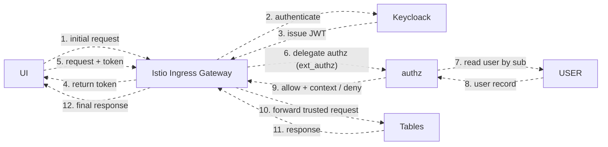

# SMS — Security Management System (security & authorization) reference

This is an **opt-in** reference covering the CBS **SMS (Security Management System)** module:
how a user is authenticated, how a request is authorized, and how user context, groups,
data access, and overrides interact. It is **not** loaded automatically with the core
context — the `proj-context` skill offers it after `system-core.md` loads, and reads it
only if the user opts in.

> **Cross-references.**
> - For the **infrastructure side** of the same auth flow (Istio Envoy filter chain,
>   `ext_authz` / `auth-context-provider`, `RequestAuthentication`, RBAC defense-in-depth,
>   header enrichment), see the infra team's (not bundled with this plugin)
>   authentication runbook. This document is the **business/domain** view; that one
>   is the **network/deployment** view of the same pipeline.
> - The `USER` table, the **SEE** and **INPUT** operations, **PRE-hooks**, plugins, and
>   `NAU`/`LIV`/`HIS` referenced below are defined in `system-core.md`.
> - **Authoritative specs (Confluence).** The full SMS specifications live in the
>   **CBSA** space:
>   <https://innowise-group.atlassian.net/wiki/spaces/CBSA/folder/4869030111>. If the
>   **Atlassian MCP** is connected, fetch that folder (and its child pages) for the
>   canonical, more detailed specs — this guide is a curated summary; those Confluence
>   pages are the source of truth.

A working mental model of the **SMS (Security Management System)** module: how a user is authenticated, how a request is authorized, and how user context, groups, data access, and overrides interact. SMS touches **many Tables**, so this guide is meant to give everyone a shared baseline.

---

## TL;DR — if you remember only this

1. **Users live in two places.** Keycloak owns *identity*; the CBS **`USER` table** owns *banking authorization data*. They are tied together by **`ID = sub`** (the JWT subject claim).
2. **Authorization is two-staged.** The **AuthZ service** (Istio external authorization) makes the **coarse** decision — *table + operation + company*. The **Table itself** makes the **fine** decision — *record- and field-level* Data Access — because only the Table knows the concrete record.
3. **The token is only a doorway.** It is validated at the ingress, the `sub` is extracted, the user context is fetched — and then **the token is not used again** downstream.
4. **Permissions are a whitelist.** No explicit grant ⇒ no access. Multiple groups merge as a **union**.
5. **There is no Projection-level authorization.** You grant access at the **Table** level; finer control is **Data Access**, not per-Projection permissions.
6. **Two kinds of "no": Error vs Override.** An **Error** is unfixable (resubmit corrected input). An **Override** is a warning that the right person can **accept** to proceed.

---

## 1. The mental model

**Why two places for users?** Keycloak holds identity but has **no concept of banking data** — groups, data-access rules, override classes, allowed days, company lists. The CBS `USER` table holds all of that. The `ID = sub` contract means every downstream component (hooks, enquiries, audit) keys off **one stable identifier** with no UUID translation.

---

## 2. The request path, component by component

### Keycloak (Identity Provider)
- Stores users and issues the **JWT** Access Token.
- Runs **inside the data plane** (it is itself reached via the cluster's inbound entry point).

### Istio Ingress Gateway / Gateway API
- The **single entry point**: practically every request entering the system goes through it.
- Routes to everything inside the data plane, **including Keycloak**.
- **Out of scope here:** external firewall and external/global load balancers. The **assumption** is the **client maintains those**. This guide covers access into the **internal network / Kubernetes cluster**.

### AuthZ service (Istio external authorization, `ext_authz`)
A **separate microservice** (not a Table) that Istio delegates the allow/deny decision to. For each request:

1. **Envoy** (the ingress proxy) calls the AuthZ service with the **JWT** + headers.
2. Extract **`sub`** from the JWT → this is the **user ID** and the `USER` table record key.
3. **Cache (smart TTL):**
   - **Hit** → take the user context from cache, validate.
   - **Miss** → **SEE** the `USER` table to fetch the context (enrichment), then store it in cache with a **TTL**.
4. **Validate:**
   - Access to **this company**?
   - Access to the **table** being addressed?
   - **Functions** (= operations): allowed to perform **this operation**?
5. **Result:** allowed → **`200`** + enriched **`CBS-User-Context`** header; otherwise **`403`**.

### Tables — the trust boundary
- A request arriving **Istio → Table** is **trusted** as already authorized. The Table does **not** redo the full authorization "just in case".
- **But the Table re-validates the rights it was handed** and enforces **record/field-level Data Access** — because only the Table knows which records exist and how they're laid out.
- **Table → Table calls propagate the original request header and SKIP the AuthZ service.** The internal call goes straight to the other Table.

### The `USER` table + plugins
- The AuthZ service resolves the user via a **SEE by RecordID**, where **RecordID = `sub`**, against the **`SM_USER`** Table.
- That Table carries **two plugins**; one is a **validation plugin** — is the user valid/invalid, what is their **status** (active/inactive) — after which the context is enriched and returned to the AuthZ service for table-level validation.

### Context-enrichment tables
- **`SM_USER_GROUPS`** — classic groups: create a group, grant it rights, attach users. A group specifies **which Tables and which operations** it may access (e.g. a `RetailTeller` group), and also carries **Data Access rules** and **Override classes**.
- **Override classes** — a separate Table; essentially **class names**.
- **Data Access** — a separate Table; the substantive record/field-level rules.

---

## 3. Authentication vs Authorization

| | Does what | Who |
|---|---|---|
| **Authentication** | Proves the user is who they claim to be; validates the token's authenticity | **Keycloak** |
| **Authorization (enrichment)** | Attaches the user's rights and decides table/operation/company access | **AuthZ service** |
| **Fine-grained enforcement** | Re-validates rights; enforces record/field Data Access | **The Table** |

A rejection for an **invalid/inauthentic token** is Keycloak's. A rejection for **insufficient rights** is the AuthZ service's (coarse) and/or the Table's (fine).

---

## 4. The permission model

- **Table-level only — no Projection-level authorization.** You grant access to a **Table** (e.g. *"this user may access `CUSTOMER`"*). You **cannot** restrict a user to one Projection but not another via permissions. Finer control is **Data Access** (record/field level), enforced at each Table.
- **Whitelist / deny-by-default.** If **nothing** is specified at the tables/functions/operations level, the user has **no access**. Access must be **explicitly granted**.
- **Additive merge.** Individual permissions and all group permissions are **unioned** together.
- **Groups are optional.** You can assign permissions and Data Accesses **directly** to a user, bypassing groups entirely.
- **Table access without a Data Access rule** ⇒ access to **all records** of that table. **With** Data Access conditions ⇒ only the **matching subset**.

### User context — what gets assembled
- **ID** — the JWT `sub`.
- **Classification** — `INTERNAL` (bank employees), `EXTERNAL` (e.g. customers), `SYSTEM` (service users).
- **Groups**, **Permissions**, **Data Access rules**.
- **Temporal policy** — when/how long access is granted *(stated tentatively)*.
- **Company list** — companies the user may act under.

---

## 5. Data Access (record- and field-level)

Data Access rules allow or deny at the **record level**, not the table level — and table-level filtering already happened at the AuthZ service, which doesn't yet know the concrete record. So Data Access is enforced **at the Table**.

- **Restrict.** Set a restriction on a **field** of a Table. Example: on `ACCOUNT`, *if `co-code == 1` then allow/deny* — evaluated against whether the operation's **result data** contains that data. This hides **specific data inside a record** from users who must not see it.
- **Grant (not only restrict).** A rule can also **open up** access: a user with **no general access** to `ACCOUNT` but a Data Access rule with a condition (e.g. *may view account ID 1*) can view **that specific record** without general table access.

### How it's applied

- **SEE / single operation** — before fetching, the Table checks the target record; if it contains data the user must not see → **deny**, else **fetch**. Implemented in the **system core** Table — **not a plugin**, it's part of the core.
- **Inquiry (list)** — an inquiry is built from **three filter sets**:
  1. **Fixed filters** — defined at inquiry creation.
  2. **User filters** — added by the user at runtime.
  3. **Data Access filters** — added at the Table level.

  Records the user can't access **simply never appear** in the result.

---

## 6. Provisioning a user

> Self-service login assumes the user's metadata already exists in SMS. It gets there via an **Admin / manager / privileged operator** creating the user — through the **INPUT operation**, not bespoke endpoints.

1. **Create the user in Keycloak first** — `SM_USER` keys off the **`sub`**, so the Keycloak identity must exist.
2. **INPUT** into the `USER` table, carrying the `sub`.
3. A **PRE-hook** calls Keycloak by that `sub` to verify the identity exists **before** persisting. If it exists → save → the user can authenticate.

### Login & company context
- At login the user supplies credentials **and selects the Company** to authorize under.
- The **company context is sent in a header** — the system must know **from which company's perspective** each request is made.

### Token facts
- The `sub` is **unique per user**, a stable per-token identifier.
- The token is **reusable**, default expiry **~5 minutes**, refreshed via a **refresh token** (**front-end** handles refresh).
- The token is used **only** to enter the ingress, extract `sub`, and fetch context — **not used downstream** and **not transformed/re-signed**.
