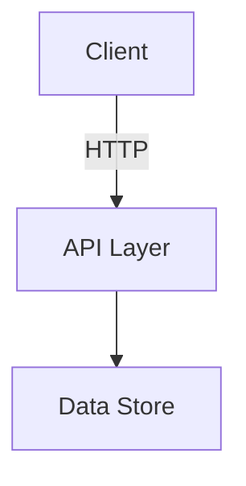

# Confluence Rules
## Documentation Guidelines

> The framework works with Jira/Confluence **read-only**; these rules describe the format of the text that a role prepares and a human publishes.

Reference for what a correct Confluence page looks like, used when reading and analysing
pages and when preparing a draft that a human publishes. The actual space, page tree, and
topics are those of the current project; check `docs/project-spec/` and `docs/frame-specs/`.

---

## 1. Space Structure

The draft names its target Confluence space; confirm it with the owner if it isn't obvious
from prior work — never assume a space name from a previous project.

A typical structure (adapt to what this project actually needs):

```
<SPACE> (Space Home)
├── Project
│   ├── Scope & Goals
│   ├── Target Audience
│   └── Success Metrics
├── Architecture
│   ├── System Architecture
│   ├── API Design
│   └── Data Model
├── Domain
│   ├── Domain Model
│   ├── Business Rules & Invariants
│   └── Glossary
├── Requirements
│   ├── Functional
│   └── Non-Functional
├── Security & Privacy
│   └── Access Control (RBAC)
├── Development
│   ├── Tech Stack
│   └── Coding Standards
├── Decisions (ADR)
└── Operations
    ├── Deployment Guide
    └── Monitoring & Alerts
```

---

## 2. Page Naming Conventions

| Type | Format | Example |
|---|---|---|
| Functional Requirement | `FR-00X: [Title]` | `FR-001: Create Account` |
| Architecture Decision | `ADR-00X: [Title]` | `ADR-001: Data Store Selection` |
| Standard page | `[Topic]` | `System Architecture` |

Never use dates in page titles. Never abbreviate domain terms.

Test cases are **not** Confluence artefacts — they live in `docs/test-cases/` (owned by the
Senior Manual QA persona, see `${CLAUDE_PLUGIN_ROOT}/commands/team/manual-qa-agent.md`). They are not drafted
as Confluence pages.

---

## 3. Page Structure

Every page must start with a **metadata block**:

```
Status: [Draft | Review | Approved | Deprecated]
Last updated: [YYYY-MM-DD]
Owner: [Name]
Related Jira Epic: [EPIC-KEY]
```

Then: title, content.

---

## 4. Diagrams

All architecture diagrams must be written in **Mermaid** format, embedded in Confluence as a
code block or diagram macro.

Example:


Exception: C4 diagrams use PlantUML, if this project uses C4 diagrams at all — confirm the
convention against whatever this project's own architecture docs already use before
introducing a new diagram style. Everything else is Mermaid.

No screenshots of diagrams. Diagrams must be editable source.

---

## 5. Functional Requirement Pages

Each FR page must contain:

1. **Description** — what the system shall do
2. **Actors** — who triggers this
3. **Preconditions**
4. **Main Flow** — numbered steps
5. **Alternative Flows** — edge cases
6. **Business Rules**
7. **API Endpoints** — linked to the API Design page
8. **Acceptance Criteria** — checklist of verifiable conditions

---

## 6. ADR Pages (Architecture Decision Records)

Each ADR must contain:

1. **Status** — Proposed | Accepted | Deprecated | Superseded
2. **Context** — why a decision was needed
3. **Decision** — what was decided
4. **Consequences** — what changes as a result
5. **Alternatives considered** — what was rejected and why

---

## 7. Jira ↔ Confluence Linking

- Every Confluence FR page must link to the corresponding Jira Epic.
- Every Jira Story must link to the relevant Confluence page in its description.
- ADR pages must be linked from the Jira Story that prompted the decision.

---

## 8. Content Rules

- Write in **English**.
- Use active voice.
- Use bullet points for lists of 3+ items.
- Use tables for structured comparisons.
- No duplicate content — link to the canonical source instead of copying.
- No placeholder text — a page is either complete or marked as `Status: Draft`.

---

## 9. What the Role Checks Before Preparing a Page Draft

1. Check (read-only) whether the page already exists in the space — the draft must not duplicate it.
2. Check that the parent page exists — the draft names the right parent in the hierarchy.
3. The draft includes the metadata block.
4. Show the page structure in the chat; the owner publishes the page.
